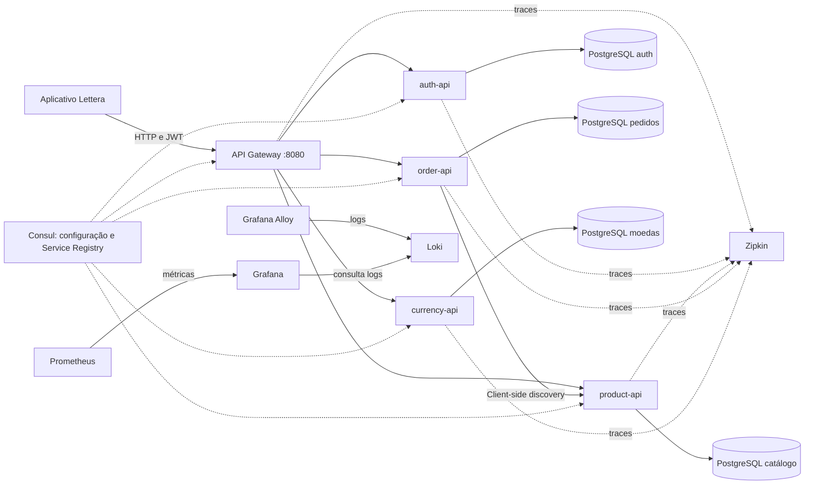

# Lettera — Backend

Backend do e-commerce de livros Lettera. O catálogo oferece livros e kits surpresa por gênero;
o carrinho permanece no app e o backend valida e registra os itens no checkout.

## Arquitetura



Cada microservice de negócio mantém seu próprio banco e suas migrations Flyway. O Gateway é stateless e é o único ponto de entrada publicado para a API de negócio. Consul centraliza configuração e descoberta; `order-api` consulta o catálogo por descoberta de serviço. A seleção de livros de um kit usa uma rota interna do `product-api`, sem rota no Gateway.

As APIs de negócio não publicam portas no host e compartilham apenas a rede interna do Compose. As rotas externas passam pelo Gateway, que valida o JWT, remove cabeçalhos de identidade enviados pelo cliente e repassa a identidade derivada do token aos serviços de negócio. A rota interna de sorteio é acessível apenas pela rede Docker e não é registrada no Gateway.

## Serviços

| Serviço | Responsabilidade | Porta interna |
| --- | --- | ---: |
| `gateway-api` | Entrada HTTP, validação JWT, autorização e roteamento | 8080 |
| `auth-api` | Cadastro de compradores, login e emissão de JWT; conta do vendedor | 8200 |
| `product-api` | Catálogo, CRUD, imagens e seleção aleatória dos kits | 8000 |
| `order-api` | Checkout, histórico do comprador e histórico de vendas | 8300 |
| `currency-api` | Serviço de moedas do projeto-base; o app Lettera usa BRL e não depende dele | 8100 |

## Inicialização com Docker Compose

Docker Desktop com Compose e Git Bash ou PowerShell. Copie `.env.example` para `.env`, preencha todos os valores vazios com valores próprios e mantenha o `.env` fora do Git. A chave JWT deve ter pelo menos 32 bytes. O modelo não contém credenciais utilizáveis; o Compose não inicia enquanto os valores obrigatórios estiverem vazios.

```powershell
Copy-Item .env.example .env
# Edite .env e preencha POSTGRES_USER, POSTGRES_PASSWORD, JWT_SECRET,
# LETTERA_ADMIN_PASSWORD, LETTERA_DEMO_BUYER_PASSWORD e GRAFANA_PASSWORD.
docker compose -f docker/docker-compose.yml up --build
```

Também é possível iniciar pelo `start_consul.bat`.
O Compose inicia Consul, carrega a configuração, aguarda os bancos e sobe os serviços.
As migrations Flyway são executadas ao iniciar cada API.
Bancos, imagens, Prometheus, Loki, Alloy e Grafana usam volumes persistentes.

Para encerrar, pressione `Ctrl+C`.
Para manter os containers em segundo plano, acrescente `-d`;
para pará-los depois, use `docker compose -f docker/docker-compose.yml down`.
Não use `down -v` se quiser preservar os dados.

O vendedor é provisionado na inicialização com o e-mail `LETTERA_ADMIN_EMAIL`
e senha `LETTERA_ADMIN_PASSWORD`.
Também é criado o comprador de demonstração `comprador@teste.com`,
com a senha definida em `LETTERA_DEMO_BUYER_PASSWORD`.
O cadastro público sempre cria compradores (`Common`);
não existe cadastro de vendedor pelo app.
Para criar outros compradores, use `/auth/signup` e depois faça login.

O projeto parte de bancos vazios: as migrations Flyway criam as tabelas e dados iniciais durante a primeira inicialização. Para recriar todo o ambiente de demonstração do zero, pare os serviços e remova os volumes do Compose; essa ação apaga os dados persistidos.

## Autenticação e regras de acesso

- `POST /auth/signup` e `POST /auth/signin` são públicos.
- `GET /products`, `GET /products/{id}` e `/images/**` são públicos.
- `/orders/**` exige JWT de comprador (`type: Common`). O id do comprador vem do JWT validado pelo Gateway.
- `/ws/**` exige JWT de vendedor (`type: Admin`). O `order-api` não aceita identidade vinda do corpo do pedido.
- O Gateway remove cabeçalhos de identidade enviados pelo cliente e os reconstitui a partir do JWT.
- A chave é compartilhada pelas variáveis `JWT_SECRET` do `auth-api` e do Gateway. Ela não deve ser reutilizada entre ambientes.

Respostas de erro usam texto simples, compatível com a tela de autenticação. Códigos principais: `400` dados inválidos, `401` token/credenciais ausentes ou inválidos, `403` perfil sem permissão, `404` recurso não encontrado e `409` conflito, incluindo livros insuficientes para um kit.

## Modelo de pedido e kit surpresa

O app envia somente `productId` e `quantity`.
O backend busca título, tipo e preço no catálogo, calcula os subtotais e o total com `BigDecimal`,
salva os dados de compra como snapshot e só então devolve o pedido.
Para cada kit, o `order-api` chama a seleção interna do `product-api`;
a estratégia Partial Fisher-Yates sorteia livros distintos da mesma categoria.
A seleção custa O(n) para copiar candidatos e O(k) para escolher k livros, sem repetição.

`GET /orders/me` retorna `id`, `createdAt`, `status`, `total` e `itemCount`.
`GET /orders/{id}` retorna `status`, linhas com `title`, `type`, `unitPrice`, `quantity`, `subtotal` e `drawnBooks`.
Para kits com quantidade maior que um, `drawnBooks` inclui `bookCount × quantity` livros.
`GET /ws/orders/sales` aceita `period` (`AAAA-MM`, padrão mês atual em UTC) e `type` (`ALL`, `BOOK` ou `KIT`),
e retorna receita, número de pedidos, itens vendidos e pedidos agrupados com suas linhas.

## Configuração, persistência e observabilidade

Consul fornece configurações de porta e datasource de cada serviço;
o Compose encaminha `JWT_SECRET`, senhas de banco, vendedor e Grafana pelo `.env`.
As imagens são gravadas no volume `product_images` e servidas publicamente pelo caminho `/images/**`.

Prometheus coleta os endpoints Actuator `/actuator/prometheus`; Grafana consulta Prometheus e Loki;
Alloy coleta logs Docker e envia para Loki; Zipkin recebe traces distribuídos.
Dashboards podem ser montados no Grafana em `http://localhost:3000`; Prometheus fica em `http://localhost:9090` e
Zipkin em `http://localhost:9411`.

As fontes Prometheus e Loki são provisionadas no Grafana pelo Compose.
Para demonstrar tracing, autentique um comprador, faça um `POST /orders` que inclua um kit e
procure no Zipkin o trace que atravessa Gateway, `order-api` e `product-api`.
Para logs, consulte o datasource Loki no Grafana; para métricas, consulte Prometheus pelo
Grafana ou diretamente pela interface do Prometheus.

Migrations ficam em `*/src/main/resources/db/migration`.
O catálogo inicia diretamente com o esquema de livros e kits, incluindo três livros de demonstração
por gênero para permitir o sorteio dos kits.

## Endpoints

Todas as rotas públicas externas usam `http://localhost:8080`. Rotas marcadas como comprador ou vendedor exigem `Authorization: Bearer <JWT>` obtido no login com o perfil correspondente.

| Método | Caminho | Acesso | Finalidade |
| --- | --- | --- | --- |
| `POST` | `/auth/signup` | Público | Cadastra comprador |
| `POST` | `/auth/signin` | Público | Autentica usuário e emite JWT |
| `GET` | `/products` | Público | Lista catálogo; aceita `category`, `type`, `search`, `page` e `size` |
| `GET` | `/products/{id}` | Público | Consulta detalhes de livro ou kit |
| `GET` | `/categories` | Público | Lista categorias existentes |
| `GET` | `/images/{arquivo}` | Público | Obtém capa enviada ao catálogo |
| `POST` | `/ws/products` | Vendedor | Cadastra livro ou kit |
| `PUT` | `/ws/products/{id}` | Vendedor | Atualiza livro ou kit |
| `DELETE` | `/ws/products/{id}` | Vendedor | Remove produto |
| `POST` | `/ws/products/{id}/image` | Vendedor | Envia imagem de capa em multipart `file` |
| `POST` | `/orders` | Comprador | Finaliza compra e registra pedido |
| `GET` | `/orders/me` | Comprador | Lista histórico de compras do usuário autenticado |
| `GET` | `/orders/{id}` | Comprador dono | Consulta pedido e livros sorteados |
| `GET` | `/ws/orders/sales` | Vendedor | Consulta vendas; aceita `period=AAAA-MM` e `type=ALL\|BOOK\|KIT` |
| `GET` | `/currencies?source=USD&target=BRL` | Público | Consulta conversão do serviço de moedas legado |
| `GET` | `/internal/kits/{kitId}/draw?quantity={n}` | Interno | Sorteia livros; chamado por `order-api`, sem rota no Gateway |

### Exemplos cURL

Os comandos abaixo usam sintaxe Bash (Git Bash no Windows). Depois do login, copie o token da resposta para a variável correspondente antes de executar as chamadas protegidas.

Cadastro e login de comprador:

```bash
export BUYER_TOKEN='<JWT retornado pelo login do comprador>'
export SELLER_TOKEN='<JWT retornado pelo login do vendedor>'

curl -i -X POST http://localhost:8080/auth/signup -H 'Content-Type: application/json' -d '{"name":"Nova Leitora","email":"nova.leitora@example.com","phone":"(11) 98765-4321","password":"Leitura@2026"}'
curl -i -X POST http://localhost:8080/auth/signin -H 'Content-Type: application/json' -d '{"email":"comprador@teste.com","password":"<LETTERA_DEMO_BUYER_PASSWORD do .env>"}'
```

Use o JWT retornado no login nos exemplos protegidos. A senha do vendedor é `LETTERA_ADMIN_PASSWORD` no `.env`.

Catálogo e categorias:

```bash
curl -i 'http://localhost:8080/products?category=Terror&type=BOOK&search=Dracula&page=0&size=10'
curl -i http://localhost:8080/products/1
curl -i http://localhost:8080/categories
curl -i 'http://localhost:8080/currencies?source=USD&target=BRL'
curl -i http://localhost:8080/images/capa.jpg
```

Gestão do catálogo (defina `SELLER_TOKEN` com o JWT do vendedor):

```bash
export SELLER_TOKEN='<JWT do vendedor>'
curl -i -X POST http://localhost:8080/ws/products -H "Authorization: Bearer $SELLER_TOKEN" -H 'Content-Type: application/json' -d '{"title":"O Iluminado","author":"Stephen King","description":"Um hotel isolado e uma família em perigo.","category":"Terror","type":"BOOK","bookCount":null,"price":49.90,"currency":"BRL","image":null}'
curl -i -X POST http://localhost:8080/ws/products -H "Authorization: Bearer $SELLER_TOKEN" -H 'Content-Type: application/json' -d '{"author":null,"description":"Três livros sorteados no checkout.","category":"Terror","type":"KIT","price":69.90,"currency":"BRL","image":null}'
curl -i -X PUT http://localhost:8080/ws/products/1 -H "Authorization: Bearer $SELLER_TOKEN" -H 'Content-Type: application/json' -d '{"title":"Drácula","author":"Bram Stoker","description":"Edição atualizada.","category":"Terror","type":"BOOK","bookCount":null,"price":44.90,"currency":"BRL","image":null}'
curl -i -X DELETE http://localhost:8080/ws/products/1 -H "Authorization: Bearer $SELLER_TOKEN"
curl -i -X POST http://localhost:8080/ws/products/1/image -H "Authorization: Bearer $SELLER_TOKEN" -F 'file=@capa.jpg'
```

Pedidos e vendas:

```bash
export BUYER_TOKEN='<JWT do comprador>'
export SELLER_TOKEN='<JWT do vendedor>'
curl -i -X POST http://localhost:8080/orders -H "Authorization: Bearer $BUYER_TOKEN" -H 'Content-Type: application/json' -d '{"items":[{"productId":1,"quantity":1},{"productId":11,"quantity":1}]}'
curl -i http://localhost:8080/orders/me -H "Authorization: Bearer $BUYER_TOKEN"
curl -i http://localhost:8080/orders/1 -H "Authorization: Bearer $BUYER_TOKEN"
curl -i 'http://localhost:8080/ws/orders/sales?period=2026-11&type=ALL' -H "Authorization: Bearer $SELLER_TOKEN"
```

A rota interna de sorteio não pode ser chamada pelo Gateway. Para inspecioná-la, execute o comando em um container conectado à rede Docker `backend`:

```bash
curl -i 'http://product-api:8000/internal/kits/11/draw?quantity=1'
```
