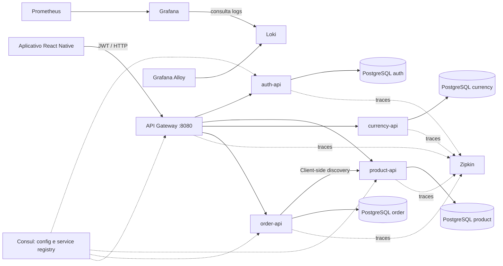

# Lettera — Backend

Backend do e-commerce de livros Lettera. O catálogo oferece livros e kits surpresa por gênero; o carrinho permanece no app e o backend valida e registra os itens no checkout.

## Arquitetura



Cada microservice de negócio mantém seu próprio banco e suas migrations Flyway. O Gateway é stateless e é o único ponto de entrada publicado para a API. Consul centraliza configuração e descoberta; `order-api` consulta o catálogo por descoberta de serviço. A seleção de livros de um kit usa uma rota interna do `product-api`, sem rota no Gateway.

## Serviços

| Serviço | Responsabilidade | Porta interna |
| --- | --- | ---: |
| `gateway-api` | Entrada HTTP, validação JWT, autorização e roteamento | 8080 |
| `auth-api` | Cadastro de compradores, login e emissão de JWT; conta do vendedor | 8200 |
| `product-api` | Catálogo, CRUD, imagens e seleção aleatória dos kits | 8000 |
| `order-api` | Checkout, histórico do comprador e histórico de vendas | 8300 |
| `currency-api` | Serviço de moedas do projeto-base; o app Lettera usa BRL e não depende dele | 8100 |

## Inicialização com Docker Compose

Requisitos: Docker Desktop com Compose e Git Bash ou PowerShell. No diretório do projeto, copie `.env.example` para `.env` e defina senhas próprias para PostgreSQL, vendedor, Grafana e uma chave aleatória para JWT com pelo menos 32 bytes. O `.env` está no `.gitignore`.

```powershell
Copy-Item .env.example .env
# Edite .env e substitua todos os valores de exemplo.
docker compose -f docker/docker-compose.yml up --build
```

Também é possível iniciar pelo `start_consul.bat`. O Compose inicia Consul, carrega a configuração, aguarda os bancos e sobe os serviços. As migrations Flyway são executadas ao iniciar cada API. Bancos, imagens, Prometheus, Loki, Alloy e Grafana usam volumes persistentes.

Para encerrar, pressione `Ctrl+C`. Para manter os containers em segundo plano, acrescente `-d`; para pará-los depois, use `docker compose -f docker/docker-compose.yml down`. Não use `down -v` se quiser preservar os dados.

O celular deve acessar o IP local do computador, por exemplo `http://192.168.0.10:8080`. Não use `localhost` no celular. Endpoints publicados para desenvolvimento: Gateway `:8080`, Consul `:8500`, Grafana `:3000`, Prometheus `:9090`, Loki `:3100` e Zipkin `:9411`. O Grafana usa o usuário `admin` e a senha definida em `GRAFANA_PASSWORD`.

O vendedor é provisionado na inicialização com o e-mail `LETTERA_ADMIN_EMAIL` (padrão `admin@admin.dev`) e senha `LETTERA_ADMIN_PASSWORD`. Também é criado o comprador de demonstração `comprador@teste.com`, com a senha definida em `LETTERA_DEMO_BUYER_PASSWORD`. O cadastro público sempre cria compradores (`Common`); não existe cadastro de vendedor pelo app. Para criar outros compradores, use `/auth/signup` e depois faça login.

## Autenticação e regras de acesso

- `POST /auth/signup` e `POST /auth/signin` são públicos.
- `GET /products`, `GET /products/{id}` e `/images/**` são públicos.
- `/orders/**` exige JWT de comprador (`type: Common`). O id do comprador vem do JWT validado pelo Gateway.
- `/ws/**` exige JWT de vendedor (`type: Admin`). O `order-api` não aceita identidade vinda do corpo do pedido.
- O Gateway remove cabeçalhos de identidade enviados pelo cliente e os reconstitui a partir do JWT.
- A chave é compartilhada pelas variáveis `JWT_SECRET` do `auth-api` e do Gateway. Ela não deve ser reutilizada entre ambientes.

Respostas de erro usam texto simples, compatível com a tela de autenticação. Códigos principais: `400` dados inválidos, `401` token/credenciais ausentes ou inválidos, `403` perfil sem permissão, `404` recurso não encontrado e `409` conflito, incluindo livros insuficientes para um kit.

## Endpoints

Use `http://localhost:8080` nos exemplos abaixo e substitua `<TOKEN>`, `<ID>` e dados de exemplo conforme necessário.

| Método e rota | Acesso | Finalidade |
| --- | --- | --- |
| `POST /auth/signup` | Público | Cria comprador |
| `POST /auth/signin` | Público | Autentica e retorna JWT |
| `GET /products` | Público | Catálogo paginado; filtros opcionais `category`, `type`, `search` |
| `GET /products/{id}` | Público | Detalhes de livro ou kit |
| `GET /images/{filename}` | Público | Recupera uma imagem do catálogo |
| `GET /currencies?source=USD&target=BRL` | Público | Cotação do serviço de moedas do projeto-base |
| `POST /ws/products` | Vendedor | Cadastra livro ou kit |
| `PUT /ws/products/{id}` | Vendedor | Atualiza livro ou kit |
| `DELETE /ws/products/{id}` | Vendedor | Remove item do catálogo |
| `POST /ws/products/{id}/image` | Vendedor | Upload multipart `file`; devolve produto atualizado |
| `POST /orders` | Comprador | Confirma carrinho e registra compra |
| `GET /orders/me` | Comprador | Lista pedidos do usuário, mais recentes primeiro |
| `GET /orders/{id}` | Comprador dono | Detalha pedido e livros sorteados |
| `GET /ws/orders/sales` | Vendedor | Retorna receita total e itens vendidos |
| `GET /internal/kits/{kitId}/draw?quantity={n}` | Interno (`order-api` → `product-api`) | Sorteia os livros do kit; não é roteado pelo Gateway |

O catálogo usa os tipos `BOOK` e `KIT`, categorias `Terror`, `Fantasia`, `Romance`, `Ficção científica` e `Suspense`, e preços em BRL. Para livros, `author` é obrigatório e `bookCount` deve ser nulo. Para kits, `bookCount` deve ser positivo e `author` é nulo. As imagens podem ser nulas; quando enviadas, o endpoint retorna um caminho relativo como `/images/uuid.jpg`.

### Exemplos cURL

Cadastro e login:

```bash
curl -i -X POST http://localhost:8080/auth/signup -H "Content-Type: application/json" -d '{"name":"Nova Leitora","email":"nova.leitora@example.com","password":"Leitura@2026"}'
curl -i -X POST http://localhost:8080/auth/signin -H "Content-Type: application/json" -d '{"email":"comprador@teste.com","password":"<valor de LETTERA_DEMO_BUYER_PASSWORD no .env>"}'
```

Catálogo, filtros e imagem pública:

```bash
curl "http://localhost:8080/products?category=Terror&type=BOOK&search=Dracula&page=0&size=10"
curl "http://localhost:8080/products/1"
curl "http://localhost:8080/currencies?source=USD&target=BRL"
curl "http://localhost:8080/images/<arquivo-da-resposta>"
```

Para chamar a rota interna de sorteio, execute o cURL de uma ferramenta conectada à rede Docker `backend`; ela não pode ser chamada pelo endereço do Gateway:

```bash
curl -i "http://product-api:8000/internal/kits/11/draw?quantity=2"
```

CRUD e upload de catálogo (defina `TOKEN` com o JWT do vendedor):

```bash
curl -i -X POST http://localhost:8080/ws/products -H "Authorization: Bearer <TOKEN>" -H "Content-Type: application/json" -d '{"title":"O Iluminado","author":"Stephen King","description":"Um hotel isolado e uma família em perigo.","category":"Terror","type":"BOOK","bookCount":null,"price":49.90,"currency":"BRL","image":null}'
curl -i -X PUT http://localhost:8080/ws/products/<ID> -H "Authorization: Bearer <TOKEN>" -H "Content-Type: application/json" -d '{"title":"O Iluminado","author":"Stephen King","description":"Edição revisada.","category":"Terror","type":"BOOK","bookCount":null,"price":52.90,"currency":"BRL","image":null}'
curl -i -X DELETE http://localhost:8080/ws/products/<ID> -H "Authorization: Bearer <TOKEN>"
curl -i -X POST http://localhost:8080/ws/products/<ID>/image -H "Authorization: Bearer <TOKEN>" -F "file=@capa.jpg"
```

Pedidos (defina `TOKEN` com o JWT do comprador):

```bash
curl -i -X POST http://localhost:8080/orders -H "Authorization: Bearer <TOKEN>" -H "Content-Type: application/json" -d '{"items":[{"productId":1,"quantity":1},{"productId":11,"quantity":2}]}'
curl -i http://localhost:8080/orders/me -H "Authorization: Bearer <TOKEN>"
curl -i http://localhost:8080/orders/<ID> -H "Authorization: Bearer <TOKEN>"
```

Histórico de vendas (defina `TOKEN` com o JWT do vendedor):

```bash
curl -i http://localhost:8080/ws/orders/sales -H "Authorization: Bearer <TOKEN>"
```

O formato de resposta e os exemplos para todos os endpoints também estão em [`requests.http`](requests.http), para abrir no IntelliJ IDEA ou VS Code com suporte a arquivos HTTP.

## Modelo de pedido e kit surpresa

O app envia somente `productId` e `quantity`. O backend busca título, tipo e preço no catálogo, calcula os subtotais e o total com `BigDecimal`, salva os dados de compra como snapshot e só então devolve o pedido. Para cada kit, o `order-api` chama a seleção interna do `product-api`; a estratégia Partial Fisher-Yates sorteia livros distintos da mesma categoria. A seleção custa O(n) para copiar candidatos e O(k) para escolher k livros, sem repetição.

`GET /orders/me` retorna `id`, `createdAt`, `total` e `itemCount`. `GET /orders/{id}` retorna linhas com `title`, `type`, `unitPrice`, `quantity`, `subtotal` e `drawnBooks`. Para kits com quantidade maior que um, `drawnBooks` inclui `bookCount × quantity` livros. `GET /ws/orders/sales` agrupa a resposta em `totalRevenue` e `sales`.

## Configuração, persistência e observabilidade

Consul fornece configurações de porta e datasource de cada serviço; o Compose encaminha `JWT_SECRET`, senhas de banco, vendedor e Grafana pelo `.env`. Não coloque `.env` no Git. As imagens são gravadas no volume `product_images` e servidas publicamente pelo caminho `/images/**`.

Prometheus coleta os endpoints Actuator `/actuator/prometheus`; Grafana consulta Prometheus e Loki; Alloy coleta logs Docker e envia para Loki; Zipkin recebe traces distribuídos. Dashboards podem ser montados no Grafana em `http://localhost:3000`; Prometheus fica em `http://localhost:9090` e Zipkin em `http://localhost:9411`.

As fontes Prometheus e Loki são provisionadas no Grafana pelo Compose. Para demonstrar tracing, autentique um comprador, faça um `POST /orders` que inclua um kit e procure no Zipkin o trace que atravessa Gateway, `order-api` e `product-api`. Para logs, consulte o datasource Loki no Grafana; para métricas, consulte Prometheus pelo Grafana ou diretamente pela interface do Prometheus.

Migrations ficam em `*/src/main/resources/db/migration`. As migrations anteriores são preservadas; a migration `V3` do catálogo arquiva as linhas antigas em `tb_product_legacy`, reinicia o catálogo ativo com livros e kits, e a migration `V2` de pedidos acrescenta snapshots e livros sorteados. Os volumes existentes preservam os dados nas próximas inicializações.
