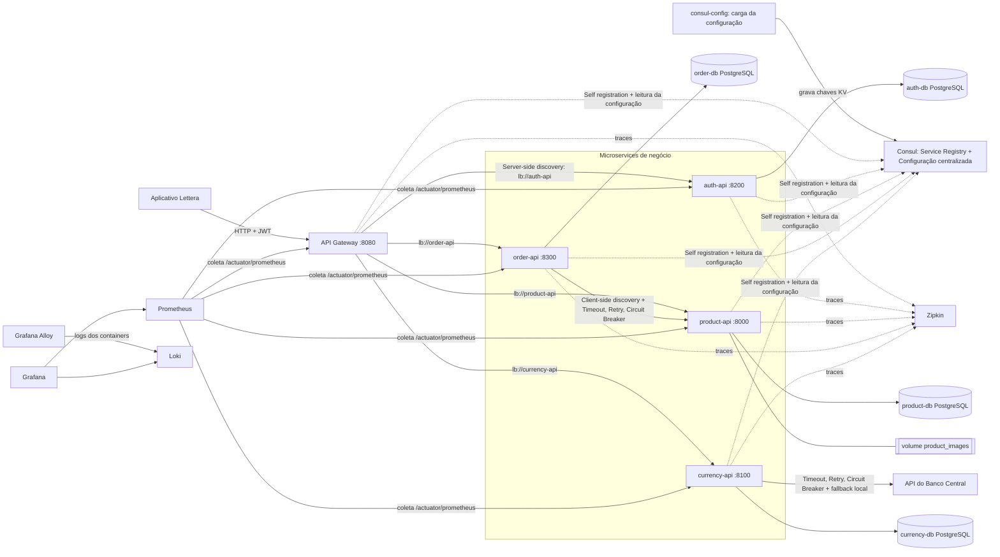

# Lettera — Backend

Backend do **Lettera**, um e-commerce de livros que, além de títulos avulsos, vende **kits temáticos surpresa**: o comprador escolhe um gênero (terror, fantasia, romance...) e os livros do kit são sorteados entre os títulos desse gênero no momento da compra.

O backend é uma arquitetura de **microservices** em Java com Spring Boot 4, executada inteiramente por Docker Compose.

## Sumário

1. [Arquitetura](#1-arquitetura)
2. [Como executar](#2-como-executar)
3. [Autenticação e regras de acesso](#3-autenticação-e-regras-de-acesso)
4. [Dados iniciais e regras do kit surpresa](#4-dados-iniciais-e-regras-do-kit-surpresa)
5. [Endpoints e cURL](#5-endpoints-e-curl)
6. [Demonstração de observabilidade e resiliência](#6-demonstração-de-observabilidade-e-resiliência)
7. [Decisões arquiteturais](#7-decisões-arquiteturais)

---

## 1. Arquitetura

### 1.1 Diagrama geral



### 1.2 Serviços

| Serviço | Responsabilidade | Porta interna | Publicada no host |
| --- | --- | --- | --- |
| `gateway-api` | Ponto único de entrada, validação do JWT, autorização por perfil, roteamento por descoberta de serviço | 8080 | Sim (8080) |
| `auth-api` | Cadastro de compradores, login e emissão do JWT; provisiona a conta do vendedor | 8200 | Não |
| `product-api` | Catálogo de livros e kits, CRUD, upload de capas, sorteio dos livros do kit | 8000 | Não |
| `order-api` | Checkout, histórico do comprador e histórico de vendas | 8300 | Não |
| `currency-api` | Serviço de cotação herdado do projeto-base (veja a [seção 7](#7-decisões-arquiteturais)) | 8100 | Não |
| `consul` | Service Registry e armazenamento da configuração centralizada | 8500 | Sim (8500) |
| `consul-config` | Job de execução única que carrega a configuração no Consul e termina | — | Não |
| `*-db` (4 instâncias) | PostgreSQL 17, um por serviço de negócio | 5432 | Não |
| `prometheus`, `loki`, `alloy`, `zipkin`, `grafana` | Observabilidade (métricas, logs, traces e visualização) | — | Sim |

### 1.3 Comunicação entre serviços

- **Externa:** o cliente fala apenas com o Gateway. Ele consulta o Consul e encaminha para `lb://<serviço>`, então o cliente não conhece endereços de microservices (**Server-side Discovery**).
- **Interna:** o `order-api` chama o `product-api` pelo nome (`http://product-api`) com cliente HTTP balanceado (**Client-side Discovery**). Ele busca título e preço do produto e pede o sorteio dos livros de cada kit. Nenhum IP ou porta fixa é usado.
- Todos os serviços se registram sozinhos no Consul ao iniciar (**Self Registration**).

### 1.4 Resiliência

| Chamada | Timeout (conexão / leitura) | Retry | Circuit Breaker | Falha vista pelo cliente |
| --- | --- | --- | --- | --- |
| `order-api` → `product-api` | 1 s / 3 s | 3 tentativas, 500 ms entre elas; erros 4xx não são repetidos | Janela de 5 chamadas, mínimo de 3, abre com 50% de falhas, 30 s aberto | `503` com a mensagem "Catálogo temporariamente indisponível" |
| `currency-api` → API do Banco Central | 2 s / 5 s | 3 tentativas, 1 s | Janela de 5, mínimo de 5, abre com 50%, 100 s aberto; cache de 10 min | Usa a cotação do banco local (fallback) |

Retry e Circuit Breaker ficam no Consul (alteráveis sem rebuild); os timeouts são definidos no cliente HTTP de cada serviço. Com o catálogo fora do ar, a compra falha de forma controlada (`503`), mas login, histórico de pedidos e demais rotas continuam funcionando.

### 1.5 Configuração centralizada e externalizada

- Porta, datasource e parâmetros de resiliência e de observabilidade de cada serviço ficam no **Consul KV** (`config/<serviço>/...` e `config/application/...`), carregados pelo `consul-config` a partir de `docker/config/load-config.sh`. Os serviços leem essa configuração ao iniciar (`spring.config.import=consul:`).
- Valores sensíveis (`JWT_SECRET`, senhas dos bancos, do vendedor e do Grafana) vêm do arquivo `docker/.env`, que não é versionado. Não há credenciais no código nem nas imagens.
- As imagens Docker são as mesmas em qualquer ambiente; basta mudar o `.env` e as chaves do Consul.

### 1.6 Persistência

Padrão **Database per Service**: cada serviço de negócio tem seu PostgreSQL e suas migrations **Flyway** (`*/src/main/resources/db/migration`), executadas na inicialização. Nenhuma tabela é compartilhada. O pedido guarda um *snapshot* de título, preço e livros sorteados, então o histórico não depende de mudanças futuras no catálogo. Os dados ficam em volumes Docker (`auth_data`, `product_data`, `order_data`, `currency_data`, `product_images`, além dos volumes de Prometheus, Loki, Alloy e Grafana).

### 1.7 Observabilidade

| Pilar | Solução | Como funciona |
| --- | --- | --- |
| **Logs** | Alloy → Loki → Grafana | O Alloy lê os logs de todos os containers e envia ao Loki; consulta no Grafana. As linhas incluem os identificadores de trace e span |
| **Métricas** | Micrometer + Prometheus + Grafana | Cada serviço expõe `/actuator/prometheus` (memória, CPU, requisições, disponibilidade); o Prometheus coleta a cada 15 s |
| **Tracing distribuído** | Micrometer Tracing + Zipkin | Amostragem de 100%; um `POST /orders` com kit gera um trace que atravessa Gateway, `order-api` e `product-api` |

### 1.8 Containerização

Cada serviço tem seu `Dockerfile` (build multi-stage, execução com usuário não-root) e roda em seu próprio container (*Service per Container*), todos no mesmo host e na rede `backend` (*Multiple Services per Host*). O `docker/docker-compose.yml` sobe tudo com healthchecks e `depends_on` por condição, na ordem: Consul e bancos → `consul-config` → `auth-api`, `product-api`, `currency-api` → `order-api` → `gateway-api`.

---

## 2. Como executar

### 2.1 Pré-requisitos

- Docker Desktop com Docker Compose.
- Git Bash ou PowerShell. Os exemplos de cURL usam sintaxe Bash (Git Bash no Windows).
- Recomendado: pelo menos 6 a 8 GB de memória para o Docker (são 5 aplicações Java, 4 bancos e a stack de observabilidade).

### 2.2 Configurar o `docker/.env`

O arquivo precisa ficar em **`docker/.env`**, ao lado do `docker-compose.yml`. Ele não é versionado.

```powershell
# PowerShell
Copy-Item .env.example docker\.env
```
```bash
# Git Bash / Linux / macOS
cp .env.example docker/.env
```

Edite `docker/.env` e preencha todos os valores. Exemplo para desenvolvimento local:

```
POSTGRES_USER=postgres
POSTGRES_PASSWORD=postgres
JWT_SECRET=ChaveSecretaDoLettera2026ComMaisDeTrintaEDoisCaracteres
LETTERA_ADMIN_EMAIL=admin@admin.dev
LETTERA_ADMIN_PASSWORD=Vendedor123
LETTERA_DEMO_BUYER_PASSWORD=Comprador123
GRAFANA_PASSWORD=Grafana123
```

Regras que os serviços verificam ao iniciar (se descumpridas, o container reinicia em loop):

| Variável | Regra |
| --- | --- |
| `JWT_SECRET` | Pelo menos **32 caracteres** (256 bits). Use uma chave diferente em cada ambiente |
| `LETTERA_ADMIN_PASSWORD` | Pelo menos **8 caracteres** |
| `LETTERA_DEMO_BUYER_PASSWORD` | Pelo menos **8 caracteres** |
| `POSTGRES_PASSWORD` | Só é aplicada na **criação** do volume do banco (veja a [seção 2.6](#26-problemas-comuns)) |
| Todas | Prefira letras e números. Caracteres como `#`, `$`, aspas e espaços podem ser cortados na leitura do arquivo |

Para gerar uma chave aleatória (PowerShell):

```powershell
-join ((48..57)+(65..90)+(97..122) | Get-Random -Count 40 | ForEach-Object {[char]$_})
```

### 2.3 Subir o ambiente

Na raiz do projeto:

```bash
docker compose -f docker/docker-compose.yml up --build -d
```

Também é possível usar o `start_consul.bat` (Windows), que executa o mesmo comando em primeiro plano. A primeira subida leva vários minutos por causa do build dos cinco serviços. Acompanhe:

```bash
docker compose -f docker/docker-compose.yml ps -a
```

O ambiente está pronto quando bancos, `auth-api`, `product-api`, `currency-api`, `order-api` e `gateway-api` aparecem como `healthy`/`Up`. O `consul-config` fica como `Exited (0)`, o que é normal (ele só carrega a configuração). Confirme no Gateway:

```bash
curl http://localhost:8080/actuator/health
```
Resposta esperada: `{"status":"UP"}`. Nenhum serviço precisa ser configurado ou iniciado manualmente.

### 2.4 Contas iniciais

| Perfil | E-mail | Senha |
| --- | --- | --- |
| Vendedor | `LETTERA_ADMIN_EMAIL` (padrão `admin@admin.dev`) | `LETTERA_ADMIN_PASSWORD` |
| Comprador de demonstração | `comprador@teste.com` | `LETTERA_DEMO_BUYER_PASSWORD` |

O cadastro público (`/auth/signup`) sempre cria **compradores**. Não existe cadastro de vendedor pelo app.

### 2.5 Endereços de apoio

| Ferramenta | Endereço | Acesso |
| --- | --- | --- |
| API (Gateway) | http://localhost:8080 | — |
| Consul (registro e configuração) | http://localhost:8500 | — |
| Grafana (logs e métricas) | http://localhost:3000 | usuário `admin`, senha `GRAFANA_PASSWORD` |
| Prometheus | http://localhost:9090 | — |
| Zipkin (traces) | http://localhost:9411 | — |

### 2.6 Problemas comuns

| Sintoma | Causa provável | Solução |
| --- | --- | --- |
| `ECONNREFUSED` na porta 8080 | O Gateway só sobe depois de todos os serviços ficarem saudáveis | Veja `docker compose -f docker/docker-compose.yml ps -a` e o log do serviço que não ficou saudável |
| `auth-api` reiniciando; log com "precisa ter pelo menos 8 caracteres" ou "ao menos 32 bytes" | Senha ou chave curta (ou cortada) no `docker/.env` | Corrija o `.env` e rode `up -d --force-recreate auth-api` |
| `password authentication failed for user "postgres"` | O volume do banco foi criado com outra senha | Recrie os volumes (comando abaixo) ou altere a senha dentro do banco |
| Erro "Set ... in .env" ao subir | `docker/.env` ausente ou com variável vazia | Preencha todas as variáveis |
| Containers sendo encerrados sem erro de aplicação | Falta de memória | Aumente a memória do Docker Desktop |

Para ver o log de um serviço:
```bash
docker compose -f docker/docker-compose.yml logs --tail 80 auth-api
```

### 2.7 Parar, reiniciar e recriar

```bash
# Parar (mantém os dados)
docker compose -f docker/docker-compose.yml down

# Recriar os containers relendo o .env (mantém os dados)
docker compose -f docker/docker-compose.yml down
docker compose -f docker/docker-compose.yml up -d

# Reset completo: APAGA todos os dados (usuários, pedidos, produtos, imagens, métricas)
docker compose -f docker/docker-compose.yml down -v --remove-orphans
docker compose -f docker/docker-compose.yml up --build -d
```

O projeto parte de bancos vazios: as migrations criam as tabelas e os dados iniciais na primeira inicialização.

---

## 3. Autenticação e regras de acesso

A autenticação é **stateless** com **JWT** assinado (HS256). O `auth-api` valida e-mail e senha (BCrypt) e emite o token, que vale por 24 horas e carrega `id`, `email` e `type` (`0` = vendedor, `1` = comprador). O Gateway valida a assinatura e a validade em cada rota protegida, remove qualquer cabeçalho `X-User-*` enviado pelo cliente e o recria a partir do token (`X-User-Id`, `X-User-Type`, `X-User-Email`). O `order-api` usa o `X-User-Id` para identificar o comprador; o id nunca é aceito pelo corpo da requisição.

| Rota | Acesso |
| --- | --- |
| `POST /auth/signup`, `POST /auth/signin` | Público |
| `GET /products`, `GET /products/{id}`, `GET /categories`, `GET /images/**`, `GET /currencies` | Público |
| `/orders/**` | Somente comprador (`type` 1) |
| `/ws/**` | Somente vendedor (`type` 0) |
| `/internal/**` | Sem rota no Gateway (só pela rede Docker) |

Respostas de erro são em texto simples (compatível com a tela de login do app). Códigos principais: `400` dados inválidos, `401` token ausente, inválido ou credenciais incorretas, `403` perfil sem permissão, `404` recurso não encontrado, `409` conflito (e-mail já cadastrado ou livros insuficientes para o kit), `413` imagem acima do limite, `503` serviço dependente indisponível. Erros internos nunca expõem detalhes da aplicação.

---

## 4. Dados iniciais e regras do kit surpresa

- O catálogo inicia com **15 livros** (3 por gênero) e **5 kits**, nos gêneros Terror, Fantasia, Romance, Ficção científica e Suspense. Na carga inicial, os ids 1 a 10 e 16 a 20 são livros (ex.: 1 = *Drácula*) e os ids 11 a 15 são kits (ex.: 11 = *Kit Terror*).
- Todo kit tem **3 livros** (`bookCount` é sempre 3) e o título é gerado como `Kit <gênero>`.
- O app envia apenas `productId` e `quantity`. O backend busca título e preço no catálogo, calcula subtotais e total com `BigDecimal`, grava o snapshot e devolve o pedido (`status` `COMPLETED`).
- Para cada kit, o `order-api` pede ao `product-api` o sorteio de livros **distintos** do mesmo gênero (Partial Fisher-Yates). Com quantidade maior que 1, são sorteados `3 × quantidade` livros.
- **Atenção:** o gênero precisa ter livros suficientes. Com apenas 3 livros de Terror, comprar 2 kits do gênero retorna `409`. Cadastre mais livros do gênero pelo endpoint do vendedor para permitir quantidades maiores.
- Quantidade por item: de 1 a 50. Imagens de capa: JPEG ou PNG, até 5 MB.

---

## 5. Endpoints e cURL

Todas as chamadas passam pelo Gateway (`http://localhost:8080`). Os exemplos usam Bash (Git Bash). Alternativa: importe qualquer comando no Postman (**Import → Raw text**) ou copie o cURL de volta com **Code → cURL**.

| Método | Caminho | Acesso | Finalidade |
| --- | --- | --- | --- |
| `POST` | `/auth/signup` | Público | Cadastra um comprador |
| `POST` | `/auth/signin` | Público | Autentica e emite o JWT |
| `GET` | `/products` | Público | Lista o catálogo (`category`, `type`, `search`, `page`, `size`) |
| `GET` | `/products/{id}` | Público | Detalhes de um livro ou kit |
| `GET` | `/categories` | Público | Lista os gêneros existentes |
| `GET` | `/images/{arquivo}` | Público | Obtém a capa de um produto |
| `POST` | `/ws/products` | Vendedor | Cadastra livro ou kit |
| `PUT` | `/ws/products/{id}` | Vendedor | Atualiza livro ou kit |
| `DELETE` | `/ws/products/{id}` | Vendedor | Remove um produto |
| `POST` | `/ws/products/{id}/image` | Vendedor | Envia a capa (multipart, campo `file`) |
| `POST` | `/orders` | Comprador | Finaliza a compra e registra o pedido |
| `GET` | `/orders/me` | Comprador | Histórico de compras do usuário autenticado |
| `GET` | `/orders/{id}` | Comprador (dono) | Detalhes do pedido e livros sorteados |
| `GET` | `/ws/orders/sales` | Vendedor | Histórico de vendas (`period`, `type`) |
| `GET` | `/currencies` | Público | Cotação entre duas moedas (serviço legado) |
| `GET` | `/internal/kits/{kitId}/draw` | Interno | Sorteia os livros de um kit (chamado pelo `order-api`) |

### Variáveis de apoio

```bash
BASE=http://localhost:8080
```

### Autenticação

**Cadastro de comprador** — `201 Created` com os dados do usuário; `409` se o e-mail já existe; `400` se faltar campo ou a senha tiver menos de 8 caracteres.
```bash
curl -i -X POST $BASE/auth/signup \
  -H 'Content-Type: application/json' \
  -d '{"name":"Nova Leitora","email":"nova.leitora@example.com","phone":"(54) 99999-0000","password":"Leitura@2026"}'
```

**Login** — `200 OK` com `user` e `token`; `401` se as credenciais forem inválidas.
```bash
curl -i -X POST $BASE/auth/signin \
  -H 'Content-Type: application/json' \
  -d '{"email":"comprador@teste.com","password":"<LETTERA_DEMO_BUYER_PASSWORD>"}'
```

**Guardar os tokens nas variáveis** (usadas nos exemplos seguintes):
```bash
BUYER_TOKEN=$(curl -s -X POST $BASE/auth/signin -H 'Content-Type: application/json' \
  -d '{"email":"comprador@teste.com","password":"<LETTERA_DEMO_BUYER_PASSWORD>"}' \
  | sed -E 's/.*"token":"([^"]+)".*/\1/')

SELLER_TOKEN=$(curl -s -X POST $BASE/auth/signin -H 'Content-Type: application/json' \
  -d '{"email":"<LETTERA_ADMIN_EMAIL>","password":"<LETTERA_ADMIN_PASSWORD>"}' \
  | sed -E 's/.*"token":"([^"]+)".*/\1/')
```

### Catálogo (público)

**Listar produtos** — `200 OK`, página com `content`. Ordenação padrão por título, 10 itens por página.
```bash
curl -i "$BASE/products?category=Terror&type=BOOK&search=Dracula&page=0&size=10"
```

**Detalhe do produto** — `200 OK`; `404` se não existir.
```bash
curl -i $BASE/products/1
```

**Categorias** — `200 OK` com a lista de gêneros.
```bash
curl -i $BASE/categories
```

**Imagem de capa** — `200 OK` com o arquivo (use o caminho devolvido no campo `image` do produto).
```bash
curl -i $BASE/images/<arquivo>.jpg
```

### Gestão do catálogo (vendedor)

**Cadastrar livro** — `201 Created`; `400` se faltar título, autor ou se o preço for inválido.
```bash
curl -i -X POST $BASE/ws/products \
  -H "Authorization: Bearer $SELLER_TOKEN" -H 'Content-Type: application/json' \
  -d '{"title":"Carrie","author":"Stephen King","description":"Uma jovem com poderes telecinéticos.","category":"Terror","type":"BOOK","price":39.90,"currency":"BRL"}'
```

**Cadastrar kit** — `201 Created`. O título é gerado (`Kit <gênero>`) e `bookCount` é sempre 3.
```bash
curl -i -X POST $BASE/ws/products \
  -H "Authorization: Bearer $SELLER_TOKEN" -H 'Content-Type: application/json' \
  -d '{"description":"Três livros escolhidos de forma surpresa.","category":"Terror","type":"KIT","price":69.90,"currency":"BRL"}'
```

**Atualizar produto** (o PUT exige todos os campos) — `200 OK`; `404` se não existir. Use o `id` devolvido no cadastro.
```bash
PRODUCT_ID=<id retornado no cadastro>
curl -i -X PUT $BASE/ws/products/$PRODUCT_ID \
  -H "Authorization: Bearer $SELLER_TOKEN" -H 'Content-Type: application/json' \
  -d '{"title":"Carrie","author":"Stephen King","description":"Edição revisada.","category":"Terror","type":"BOOK","price":34.90,"currency":"BRL"}'
```

**Enviar capa** — `200 OK` com o caminho da imagem; `400` para formato que não seja JPEG/PNG; `413` acima de 5 MB.
```bash
curl -i -X POST $BASE/ws/products/$PRODUCT_ID/image \
  -H "Authorization: Bearer $SELLER_TOKEN" \
  -F 'file=@capa.jpg;type=image/jpeg'
```

**Remover produto** — `204 No Content`; `404` se não existir.
```bash
curl -i -X DELETE $BASE/ws/products/$PRODUCT_ID \
  -H "Authorization: Bearer $SELLER_TOKEN"
```

### Pedidos (comprador)

**Finalizar compra** — `201 Created` com o pedido, `total` e `drawnBooks` de cada kit; `404` produto inexistente; `409` livros insuficientes para o kit; `503` se o catálogo estiver indisponível.
```bash
curl -i -X POST $BASE/orders \
  -H "Authorization: Bearer $BUYER_TOKEN" -H 'Content-Type: application/json' \
  -d '{"items":[{"productId":1,"quantity":1},{"productId":11,"quantity":1}]}'
```

**Histórico de compras** — `200 OK` com `id`, `createdAt`, `status`, `total` e `itemCount`, do mais recente para o mais antigo.
```bash
curl -i $BASE/orders/me -H "Authorization: Bearer $BUYER_TOKEN"
```

**Detalhes do pedido** — `200 OK` com os itens (`title`, `type`, `unitPrice`, `quantity`, `subtotal`, `drawnBooks`); `404` se o pedido não existir ou for de outro comprador.
```bash
curl -i $BASE/orders/1 -H "Authorization: Bearer $BUYER_TOKEN"
```

### Vendas (vendedor)

**Histórico de vendas** — `200 OK` com receita, número de pedidos, itens vendidos e os pedidos do período. `period` no formato `AAAA-MM` (padrão: mês atual, em UTC) e `type` entre `ALL`, `BOOK` e `KIT`.
```bash
curl -i "$BASE/ws/orders/sales?period=2026-11&type=ALL" \
  -H "Authorization: Bearer $SELLER_TOKEN"
```

### Serviço de moedas (legado)

**Cotação** — `200 OK`; `400` para códigos inválidos; `404` se não houver cotação. Consulta o Banco Central e, se estiver indisponível, usa o banco local.
```bash
curl -i "$BASE/currencies?source=USD&target=BRL"
```

### Rota interna

**Sorteio dos livros do kit** — sem rota no Gateway. Só é acessível de dentro da rede Docker:
```bash
docker run --rm --network docker_backend curlimages/curl \
  -i "http://product-api:8000/internal/kits/11/draw?quantity=1"
```

---

## 6. Demonstração de observabilidade e resiliência

### 6.1 Service Discovery e configuração (Consul)

Abra http://localhost:8500. Em **Services** aparecem `gateway-api`, `auth-api`, `product-api`, `order-api` e `currency-api` registrados. Em **Key/Value → config** está a configuração de cada serviço.

### 6.2 Tracing (requisição por dois ou mais serviços)

1. Faça login como comprador e envie o `POST /orders` com um kit (veja a seção 5).
2. Abra http://localhost:9411, escolha o serviço `gateway-api` e clique em **RUN QUERY**.
3. Abra o trace mais recente: ele mostra o percurso `gateway-api` → `order-api` → `product-api` e o tempo de cada etapa.

### 6.3 Métricas

Abra http://localhost:9090 → **Status → Targets** (todos `UP`). Na aba **Graph**, consulte, por exemplo, `up` ou `http_server_requests_seconds_count`. No Grafana, a fonte Prometheus já vem provisionada.

### 6.4 Logs centralizados

Abra http://localhost:3000 (usuário `admin`) → **Explore** → fonte **Loki** → filtre por `container_name` (por exemplo, `order-api`) → **Run query**. Faça uma compra e atualize para ver as novas linhas.

### 6.5 Resiliência (Timeout, Retry e Circuit Breaker)

```bash
# 1. Derrube o catálogo
docker compose -f docker/docker-compose.yml stop product-api

# 2. Repita a compra algumas vezes
for i in 1 2 3 4 5 6; do
  curl -s -o /dev/null -w "$i -> %{http_code} em %{time_total}s\n" -X POST $BASE/orders \
    -H "Authorization: Bearer $BUYER_TOKEN" -H 'Content-Type: application/json' \
    -d '{"items":[{"productId":1,"quantity":1}]}'
done

# 3. Rotas que não dependem do catálogo continuam funcionando
curl -i $BASE/orders/me -H "Authorization: Bearer $BUYER_TOKEN"

# 4. Religue o catálogo (as compras voltam após cerca de 30 s)
docker compose -f docker/docker-compose.yml start product-api
```

As primeiras compras demoram mais (tentativas e timeout) e retornam `503`; depois que o Circuit Breaker abre, as falhas passam a ser imediatas.

### 6.6 Persistência

```bash
docker compose -f docker/docker-compose.yml down
docker compose -f docker/docker-compose.yml up -d
```
Sem `-v`, usuários, pedidos, produtos e imagens continuam disponíveis.

---

## 7. Decisões arquiteturais

1. **Consul para configuração e descoberta.** Um único serviço de apoio faz o Service Registry e a configuração centralizada (KV), no lugar do par Spring Cloud Config Server + Eureka. Reduz o número de containers e oferece health checks nativos.
2. **Configuração externalizada.** Porta, datasource e parâmetros de resiliência e observabilidade ficam no Consul, carregados por um job único (`consul-config`). Segredos vêm do `docker/.env`. Os usuário e senha do banco são gravados no Consul KV em texto simples, o que é adequado a este ambiente acadêmico; em produção, o recomendado é usar ACLs do Consul ou um cofre de segredos (por exemplo, Vault).
3. **Database per Service.** Quatro instâncias PostgreSQL, uma por serviço de negócio, com Flyway. O pedido guarda um snapshot dos dados do produto para não depender do catálogo depois da compra.
4. **Identidade entre serviços.** O Gateway valida o JWT e repassa a identidade por cabeçalhos `X-User-*`, recriados a cada requisição. Os serviços de negócio não publicam portas e confiam na rede interna do Compose. A chave HS256 é simétrica e compartilhada por `auth-api` e Gateway; uma evolução seria assinar com chave assimétrica (RS256) e validar nos serviços.
5. **Autorização no Gateway.** O controle por perfil (`/ws/**` para vendedor, `/orders/**` para comprador) é feito no Gateway. No `order-api`, o acesso aos pedidos é restrito ao comprador dono (`X-User-Id`).
6. **Rota interna de sorteio.** `/internal/kits/{id}/draw` não tem rota no Gateway: só é chamada pelo `order-api`, dentro da rede Docker.
7. **Carrinho no aplicativo.** O carrinho fica no app; o backend valida os itens e registra o pedido apenas no checkout.
8. **`currency-api` mantido.** É o serviço do projeto-base, mantido porque demonstra Retry, Circuit Breaker, cache e fallback contra uma API externa. O fluxo de negócio do Lettera usa apenas BRL e não depende dele (o `product-api` tem um cliente para esse serviço herdado, mas não o chama).
9. **Resiliência.** Retry e Circuit Breaker externalizados no Consul; timeouts definidos nos clientes HTTP. Erros 4xx do catálogo não são repetidos nem contam para abrir o circuito. Falhas de dependência viram `503` com mensagem controlada.
10. **Observabilidade.** O Prometheus usa alvos estáticos pelo DNS do Compose (sem service discovery do Consul) por simplicidade. A amostragem de traces é de 100%, adequada para demonstração; em produção, use uma taxa menor. O Alloy lê os logs pelo socket do Docker.
11. **Respostas de erro em texto simples**, para serem exibidas diretamente pela tela de autenticação do aplicativo.
12. **Kits.** O número de livros do kit é fixo em 3 e o título é gerado a partir do gênero. As capas ficam no volume `product_images` e são servidas publicamente pelo `product-api`.

---

## Estrutura do repositório

```
auth-api/        Autenticação e usuários
product-api/     Catálogo, imagens e sorteio de kits
order-api/       Pedidos e vendas
currency-api/    Cotações (serviço legado)
gateway-api/     API Gateway
docker/          docker-compose.yml, carga de configuração do Consul e configurações de observabilidade
.env.example     Modelo do arquivo docker/.env
requests.http    Coleção de requisições para o IntelliJ
start_consul.bat Atalho para subir o ambiente no Windows
```